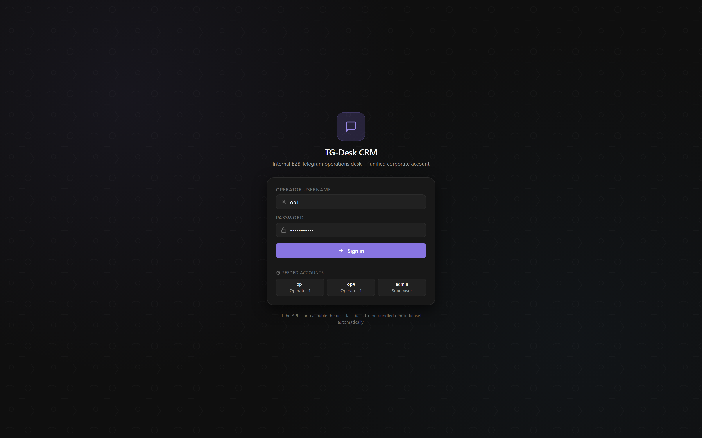
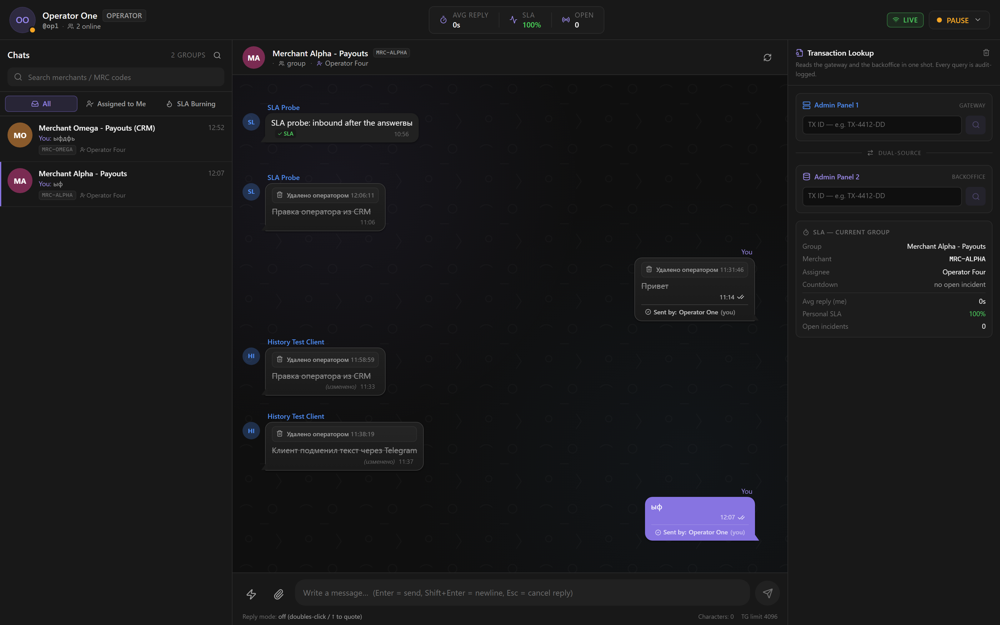
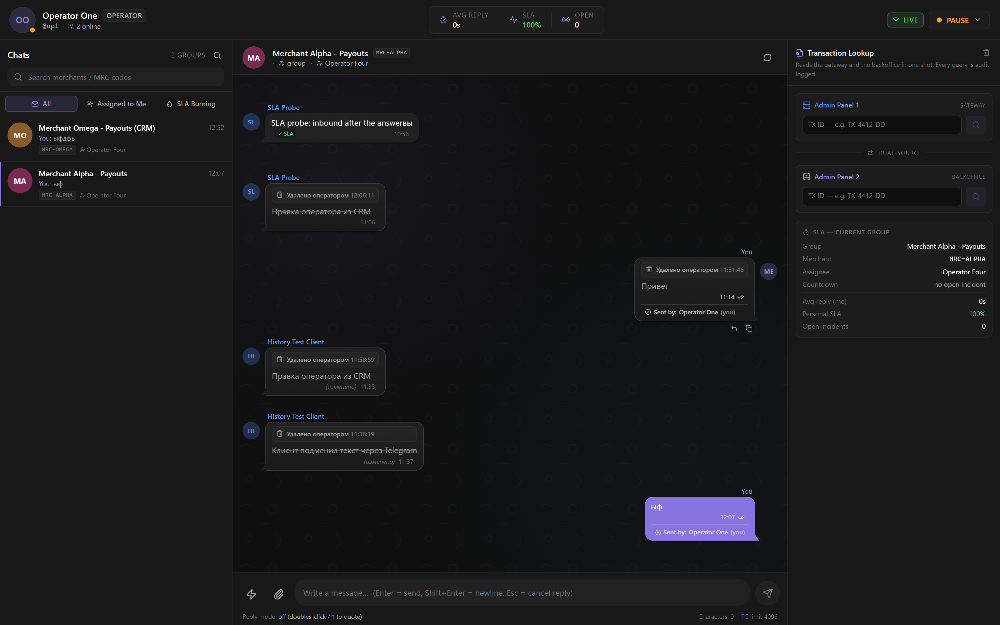
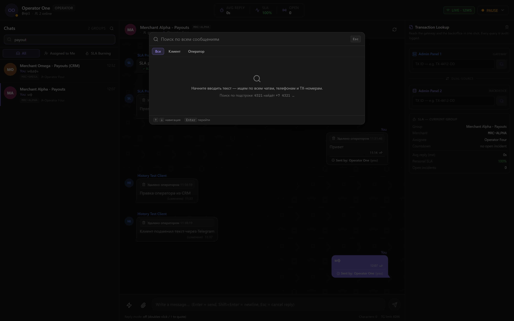
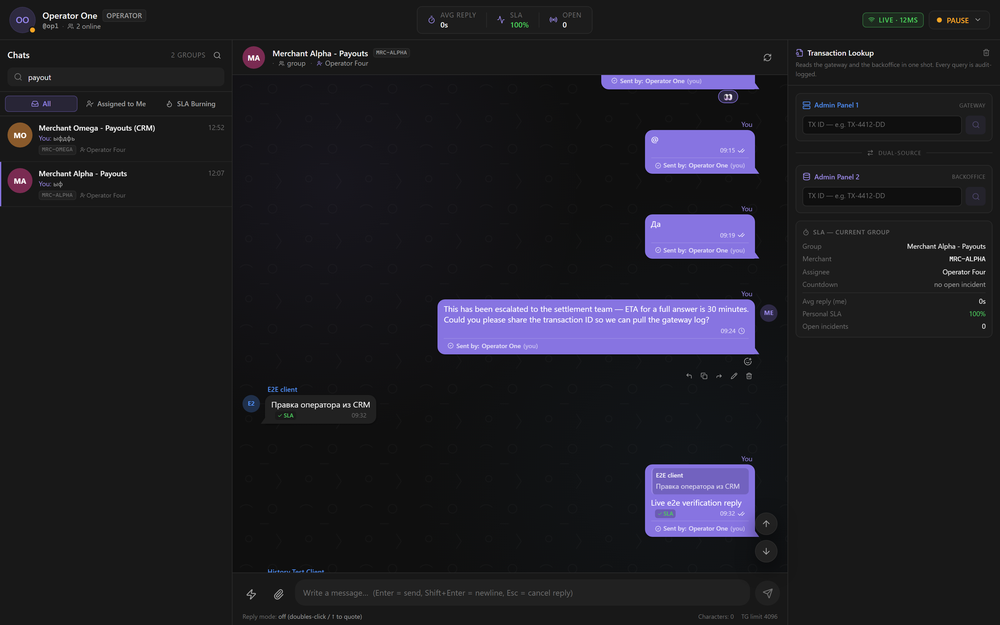
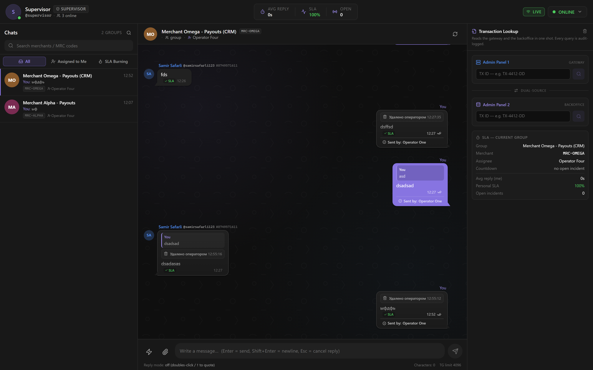

<div align="center">

# 💬 TG-Desk CRM

**Внутренний B2B-операционный Telegram CRM для команды поддержки мерчантов**

Один корпоративный аккаунт Telegram → одна управляемая рабочая станция оператора

[](https://www.python.org/)
[](https://fastapi.tiangolo.com/)
[](https://react.dev/)
[](https://www.typescriptlang.org/)
[](https://www.postgresql.org/)
[](https://redis.io/)
[](https://docs.telethon.dev/)

[](#-проверка-качества)
[](#)
[](#)

</div>

---

## 🎯 Зачем это

Мерчанты пишут в Telegram, а поддержка тонет в одном общем аккаунте: непонятно, кто взял чат, кто ответил, кто нарушил SLA, и не потерялось ли сообщение после того, как клиент удалил его у себя.

**TG-Desk CRM** превращает один Telegram-аккаунт в управляемую рабочую станцию:

- 👥 операторы видят **общую очередь** и не мешают друг другу;
- ⏱️ руководитель **контролирует скорость ответа** через SLA-движок;
- 🔍 любое сообщение находится **за секунды** глобальным поиском;
- 🛡️ переписка **не теряется**, даже если клиент удалил её у себя.

---

## 📸 Интерфейс

<div align="center">

### 🔐 Вход в систему



### 💻 Рабочее место оператора



</div>

<table>
<tr>
<td width="50%">

### 😂 Реакции в реальном времени



</td>
<td width="50%">

### 🔍 Глобальный поиск (Ctrl+K)



</td>
</tr>
<tr>
<td width="50%">

### ⬆️⬇️ Навигация по истории



</td>
<td width="50%">

### ⏱️ Настройки SLA



</td>
</tr>
</table>

---

## ✨ Возможности

### 💻 Рабочее место оператора

| | Возможность | Что даёт |
|:---:|---|---|
| 📋 | **Общая очередь чатов** | Группы, клиенты и боты в одном списке, фильтры «Все / Мои / Горящие» |
| ⏱️ | **SLA-таймер на каждом чате** | Видно, сколько осталось до нарушения, ещё до того как оно случилось |
| 🔒 | **Защита от двойного ответа** | `TYPING_LOCK` — если коллега уже печатает в чат, вы об этом узнаете |
| 🏷️ | **Атрибуция «Sent by: op»** | Под каждым исходящим видно, кто именно ответил |
| 💬 | **Ответы с цитированием** | Нативное цитирование Telegram с переходом к исходному сообщению |
| 🖼️ | **Медиа в обе стороны** | Фото, документы, видео — отправка и приём с превью |
| 😂 | **Реакции в реальном времени** | 6 эмодзи с отрисовкой за ~40 мс и зеркалированием в Telegram |
| 🗑️ | **Удаление сообщений** | Удаление из CRM с зеркалированием в Telegram; в CRM остаётся серый след |
| ✏️ | **Редактирование** | Правка своих сообщений с асимметричной историей изменений |
| ↪️ | **Пересылка** | Перенос сообщений между чатами с сохранением автора |
| ⚡ | **Быстрые ответы** | Редактируемые шаблоны с созданием, правкой и порядком прямо из интерфейса |
| 🔍 | **Глобальный поиск** | `Ctrl+K` — поиск по всем чатам сразу, с подсветкой и переходом к сообщению |
| ⬆️ | **Навигация по истории** | Кнопки вверх/вниз и автопрокрутка к новым сообщениям при открытии чата |

### 👔 Панель руководителя

- ⏱️ **Настройки SLA** — включение, цель ответа в секундах, сброс счётчика при ответе оператора
- 👥 **Управление операторами** — роли, смены, права, персональные цели SLA
- 🔑 **Учётные записи Telegram** — подключение аккаунтов с шифрованием сессий
- 📜 **Журнал аудита** — каждое действие с настройками и операторами

### 🎭 Роли

| Роль | Права |
|:---:|---|
| 👤 `OPERATOR` | Свои чаты, ответы, реакции, быстрые ответы |
| 👀 `SUPERVISOR` | Видит всех и настройки SLA в режиме чтения, управляет очередью |
| 👑 `ADMIN` | Полный доступ, включая настройки и учётные записи |

---

## ⏱️ Движок SLA

Ключевое правило — **отсчёт идёт от последнего сообщения клиента, ответ оператора его обнуляет**:

```text
Клиент написал ──► таймер пошёл ──► оператор ответил ──► таймер закрыт
                        │                                      │
                        │ повторное сообщение клиента          │
                        └──► НЕ продлевает дедлайн            │
                                                               ▼
                                        следующее сообщение клиента
                                             запускает новый отсчёт
```

Цель ответа настраивается в три уровня, побеждает более конкретный:

| Приоритет | Источник | Где меняется |
|:---:|---|---|
| 1️⃣ | Персональная цель оператора | `operators.sla_target_seconds` |
| 2️⃣ | Глобальная цель | `app_settings.sla_target_seconds` |
| 3️⃣ | Значение из конфигурации | `BACKEND_SLA_SECONDS` |

---

## 🏗️ Архитектура

```text
┌──────────────────────────────────────────────────────────────────┐
│  🎨 Frontend · React 18 + TypeScript strict + Zustand + Vite     │
│  Операторская станция и панель руководителя                      │
└────────────────────────────┬─────────────────────────────────────┘
                             │  REST /api  +  WebSocket /ws
┌────────────────────────────▼─────────────────────────────────────┐
│  ⚙️ Backend API · FastAPI + SQLAlchemy 2.0 (async)               │
│  Аутентификация · SLA-движок · поиск · аудит · WebSocket-хаб     │
└───────┬──────────────────────────────────┬───────────────────────┘
        │                                  │
┌───────▼────────┐              ┌──────────▼──────────────────────┐
│  🐘 PostgreSQL │              │  ⚡ Redis Pub/Sub               │
│  Чаты, сообщения│             │  Каналы событий между слоями    │
│  SLA, аудит    │              └──────────┬──────────────────────┘
└────────────────┘                         │
                             ┌─────────────▼───────────────────────┐
                             │  📡 Telethon Worker · MTProto       │
                             │  Живая сессия Telegram, медиа,      │
                             │  реакции, удаление, пересылка       │
                             └─────────────┬───────────────────────┘
                                           │
                                    ┌──────▼──────┐
                                    │ ✈️ Telegram │
                                    └─────────────┘
```

> 💡 **Почему так.** Бэкенд и воркер общаются только через Redis — их можно перезапускать независимо, а падение одного не уносит второй. Telegram остаётся источником истины для доставки, но не для данных: если воркер недоступен, CRM продолжает работать.

### 📡 Каналы событий

| Направление | Канал | Назначение |
|:---:|---|---|
| Worker → Backend | `tg_incoming` | Новое сообщение из Telegram |
| Worker → Backend | `tg_deleted` | Клиент удалил сообщение |
| Worker → Backend | `tg_edits` | Сообщение отредактировано |
| Worker → Backend | `tg_reactions` | Изменились реакции |
| Worker → Backend | `tg_outgoing_ack` | Подтверждение отправки |
| Backend → Worker | `tg_outgoing` | Отправить сообщение |
| Backend → Worker | `tg_forward` | Переслать сообщение |
| Backend → Worker | `tg_reaction_out` | Поставить реакцию |
| Backend → Worker | `tg_delete_out` | Удалить сообщение |

---

## 🛠️ Стек

| Слой | Технологии |
|:---:|---|
| 🎨 **Frontend** | React 18 · TypeScript (strict) · Zustand · Vite · Tailwind CSS · lucide-react |
| ⚙️ **Backend** | Python 3.12 · FastAPI · SQLAlchemy 2.0 async · asyncpg · Pydantic v2 · WebSocket |
| 🗄️ **База** | PostgreSQL 16 (`pg_trgm` для поиска) · Redis 7 (Pub/Sub) |
| ✈️ **Telegram** | Telethon 1.37 (MTProto) · StringSession |
| 📦 **Инфраструктура** | Docker Compose · Makefile + PowerShell-скрипты |

---

## 🚀 Быстрый старт

**1️⃣ Конфигурация**

```bash
cp .env.example .env
```

**2️⃣ База и Redis**

```bash
docker compose -f docker-compose.dev.yml up -d
```

**3️⃣ Зависимости**

```bash
python -m venv .venv
.venv/Scripts/pip install -r backend/requirements.txt
cd frontend && npm install && cd ..
```

**4️⃣ Схема и демо-данные**

```bash
python backend/migrate_v4.py
python backend/migrate_v5_delete_permission.py
python backend/seed.py
```

**5️⃣ Запуск (три терминала)**

```bash
# Терминал 1 — API
cd backend && python -m uvicorn app.main:app --port 8000

# Терминал 2 — воркер Telegram
cd telethon_worker && python worker.py

# Терминал 3 — интерфейс
cd frontend && npm run dev
```

🎉 Откройте **http://localhost:5173**

### 🔑 Учётные записи для входа

| Логин | Пароль | Роль | Доступ |
|:---:|:---:|:---:|---|
| `op1` … `op10` | `operator123` | 👤 Оператор | Рабочее место |
| `supervisor` | `admin123` | 👀 Супервизор | Очередь + SLA (чтение) |
| `admin` | `admin123` | 👑 Администратор | Всё, панель `/admin` |

> ⚠️ **Перед публичным развёртыванием** смените `BACKEND_SECRET_KEY`, пароли и укажите реальные `TG_API_ID` / `TG_API_HASH` из [my.telegram.org](https://my.telegram.org).

---

## ✅ Проверка качества

Проект поставляется с исполняемыми наборами проверок — они ходят в **живой API и в базу**, а не подменяют их моками.

```bash
# 🧪 Модульные тесты
cd backend         && pytest -q      # 86 тестов
cd telethon_worker && pytest -q      # 103 теста

# 🔬 Сквозные проверки на работающем стенде
python backend/verify_e2e.py              # базовые сценарии
python backend/verify_v3.py               # пересылка и история правок
python backend/verify_v5_search_sla.py    # поиск и настройки SLA
python backend/verify_v5_sla_rule.py      # правило сброса SLA
python backend/verify_v5_delete_live.py   # удаление сообщений
python backend/verify_quick_replies_live.py
```

| Набор | Покрытие | Статус |
|---|---|:---:|
| `backend` · `pytest` | API, схемы, безопасность, SLA | ✅ 86 |
| `telethon_worker` · `pytest` | MTProto, медиа, реакции, удаление | ✅ 103 |
| Сквозные сценарии | Полный путь сообщения | ✅ 28/28 |
| Пересылка и правки | V3 | ✅ 26/26 |
| Поиск и SLA | V5 | ✅ 19/19 |
| Правило сброса SLA | V5 | ✅ 11/11 |
| Удаление сообщений | V5 | ✅ 26/26 |
| Быстрые ответы | V5 | ✅ 35/35 |
| UI (Playwright) | Удаление, поиск, SLA, прокрутка | ✅ 99/99 |

---

## 📁 Структура

```text
📦 tg-desk-crm
├── ⚙️ backend/
│   ├── app/
│   │   ├── models.py          модели и ограничения БД
│   │   ├── schemas.py         контракты API
│   │   ├── routers/           HTTP-эндпоинты
│   │   ├── services/          доменная логика (SLA, поиск, удаление…)
│   │   └── background.py      фоновые задачи и шина событий
│   ├── tests/                 модульные тесты
│   ├── migrate_*.py           идемпотентные миграции
│   └── seed.py                демо-данные
├── 🎨 frontend/
│   └── src/
│       ├── components/        интерфейс оператора
│       ├── pages/             панель руководителя
│       ├── store/             состояние (Zustand)
│       └── lib/               API-клиент и типы
├── 📡 telethon_worker/
│   └── worker.py              мост в Telegram через MTProto
├── 📸 docs/screenshots/       изображения для этого файла
├── 📜 CONTRACTS*.md           проектные контракты
└── 🐳 docker-compose.dev.yml
```

---

## 📜 Проектные контракты

Разработка велась по последовательности неизменяемых контрактов — они лежат в репозитории и описывают точные требования к API, данным и инвариантам:

| Файл | Содержание |
|---|---|
| 📄 [`CONTRACTS.md`](CONTRACTS.md) | Ядро: чаты, сообщения, SLA, аутентификация |
| 📄 [`CONTRACTS_V2.md`](CONTRACTS_V2.md) | Медиа, реакции, боты, администрирование |
| 📄 [`CONTRACTS_V3.md`](CONTRACTS_V3.md) | Пересылка и история редактирования |
| 📄 [`CONTRACTS_V4.md`](CONTRACTS_V4.md) | Двунаправленные реакции |
| 📄 [`CONTRACTS_V5.md`](CONTRACTS_V5.md) | Удаление, настройки SLA, быстрые ответы, поиск |

---

## ⚠️ Ограничения

- 🏢 Рассчитан на **один корпоративный аккаунт** Telegram; мультиаккаунтность заложена, но не оттестирована в проде
- 🔍 Поиск работает по загруженным сообщениям с индексами `pg_trgm`; архив глубже лимита пагинации не индексируется
- 💾 Медиа хранится на локальном диске — для кластера нужен объектный storage
- 🗃️ Схема БД обновляется идемпотентными скриптами `migrate_*.py`, без Alembic

---

## 🔒 Безопасность

- 🔐 Пароли — bcrypt, токены — JWT с ограниченным временем жизни
- 🛡️ Сессии Telegram шифруются at rest (Fernet)
- 👮 Роли проверяются на уровне эндпоинтов, а не только в интерфейсе
- 📜 Все действия с настройками и операторами попадают в журнал аудита
- 🙈 `.env`, сессии и медиа исключены из репозитория через `.gitignore`

---

<div align="center">

**Сделано для команды поддержки мерчантов** 💙

<sub>Внутренний инструмент. Не является официальным продуктом Telegram.</sub>

</div>
